# Space Commander

**A fast disk space analyzer for Windows that tells you where the space went, what is safe to remove, and exactly why it asks for administrator rights.**

Built with Rust and Tauri 2. The installer is about 2.5 MB.

[](https://github.com/legostin/space-commander/actions/workflows/build.yml)
[](LICENSE)

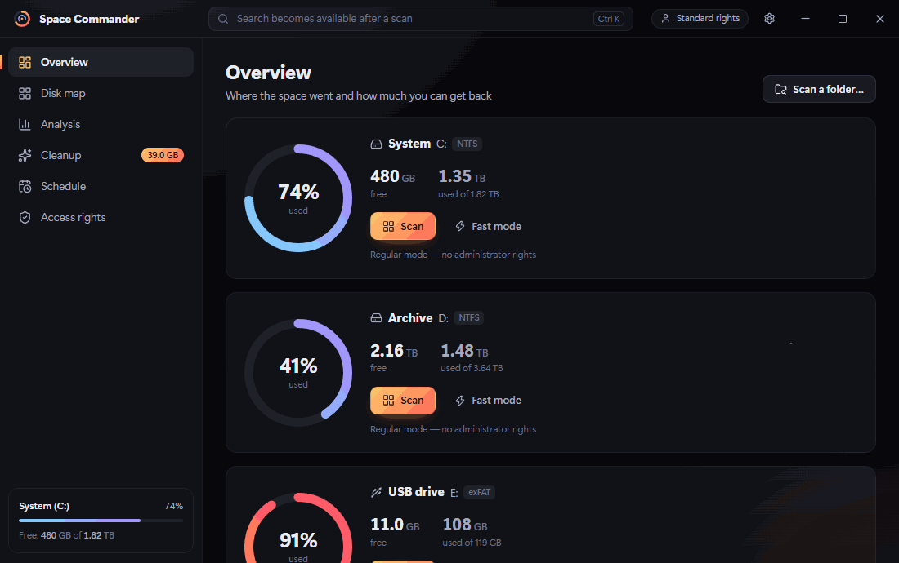

English · [Русский](docs/README.ru.md)

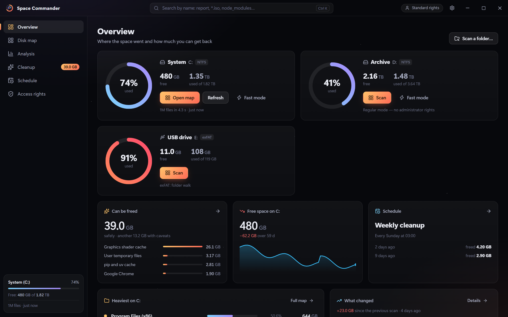

## What it does

### Disk map

A treemap of the whole drive, colored by file type, next to a sorted folder list. Double-click to dive into a folder, right-click for actions, press `Ctrl+K` to search every file name (wildcards like `*.iso` work). Hidden and system items can be switched off, and the totals are recalculated to match what you see.

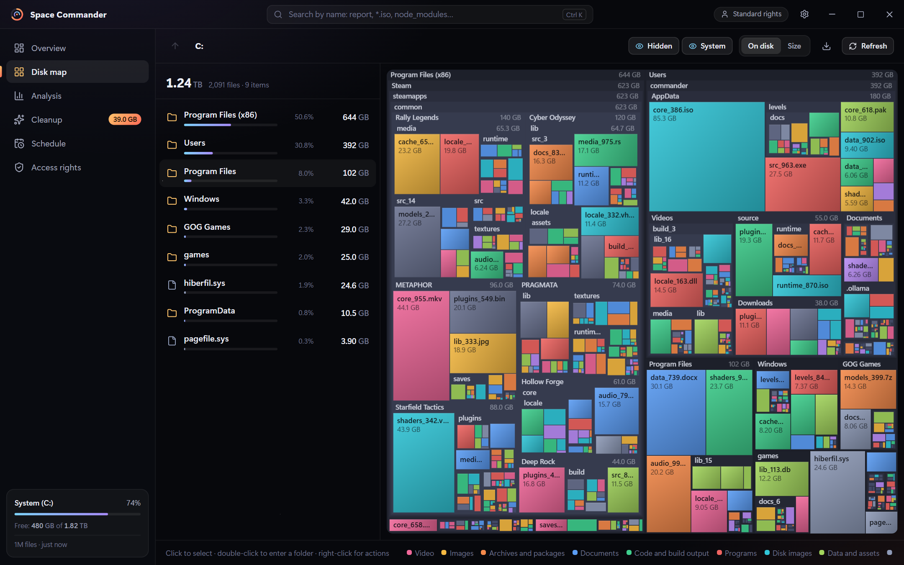

### Two scan engines

| | Regular mode | Fast mode |
|---|---|---|
| How | Parallel folder walk | Reads the NTFS master file table (`$MFT`) directly |
| Rights | None | Administrator |
| 1.9 million files on an NVMe drive | about 40 s cold, 4–5 s warm | 3–5 s |
| Folders locked by the system | Skipped and listed | Read |

The last scan is cached, so the map opens instantly on the next launch and refreshes in the background.

### What changed since last time

Every scan leaves a small snapshot of folder sizes. The **Changes** tab compares any two scans and shows the deepest folder responsible for each change, instead of a chain of parents that all grew by the same amount.

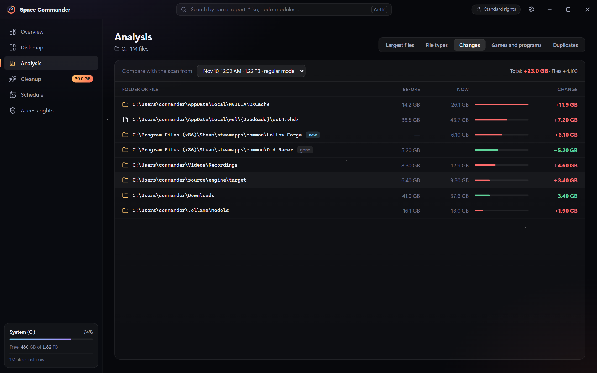

### Cleanup that shows its work

System junk, browser caches, app caches and developer tool caches (npm, pip, Cargo, Gradle, NuGet and more). Chromium- and Electron-based apps are detected automatically. Every rule lists the exact folders it will touch and carries a risk label; running apps are detected and skipped by default.

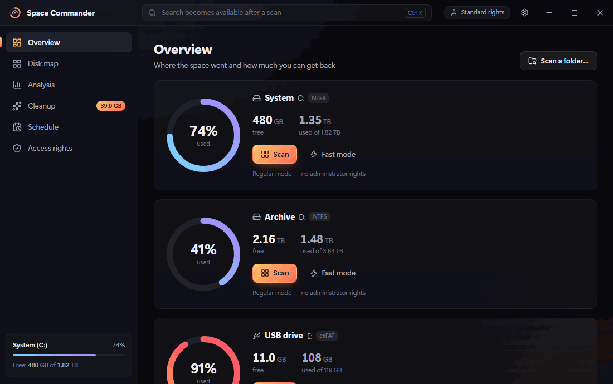

Deletion is conservative: only the contents of the listed folders, links and junctions are never followed, files in use are skipped, and root system folders are refused outright.

### Games and programs

Installed Steam, Epic Games and GOG titles plus everything from *Apps & features*, with real sizes taken from the scan and, for Steam, the date you last played.

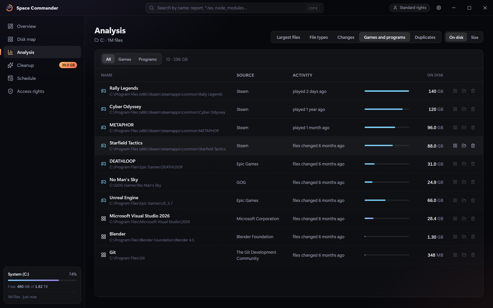

### Scheduled tasks without a background process

Tasks are registered in Windows Task Scheduler, so nothing sits in the tray. A task can clean selected rules, run only when free space drops below a threshold, warn when a drive is nearly full, and notify you when a folder has grown by more than a set amount.

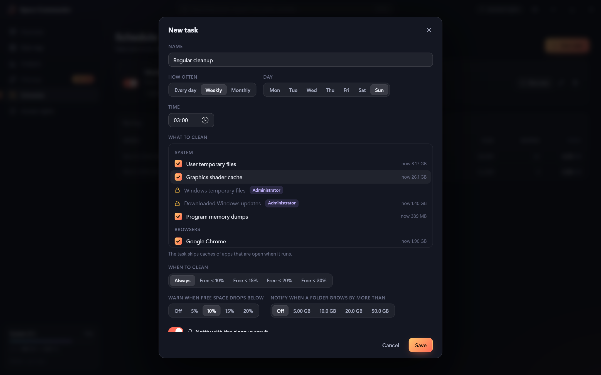

### Administrator rights, explained

Space Commander works without elevation. When something does need it, you first see the full chain: what you asked for, what it requires, why Windows restricts it, what the app will do and what happens if you decline.


### Also

- Largest files, optionally only those untouched for six months, a year or two years
- Breakdown by file type
- Duplicate finder that compares contents and ignores hard links and cloud placeholders
- Scan a single folder, a network path or an external drive
- CSV export
- Dark and light themes

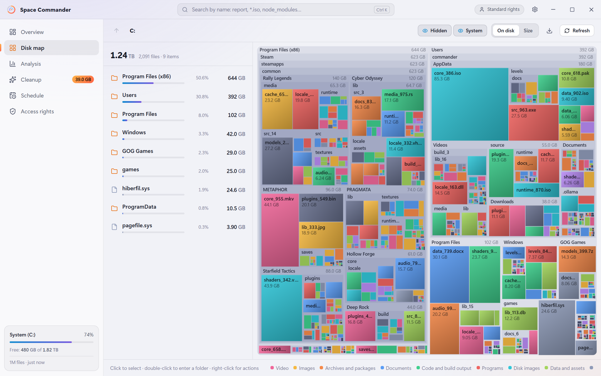

## Languages

English, Russian, Spanish, German, French, Brazilian Portuguese, Simplified Chinese and Japanese.

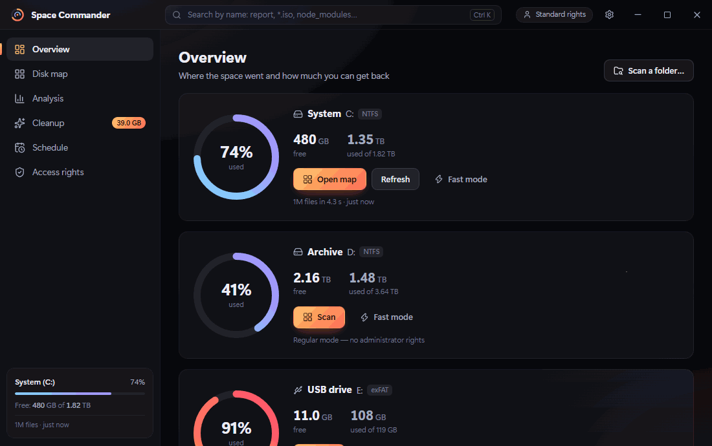

| Deutsch | 日本語 |
|---|---|
| 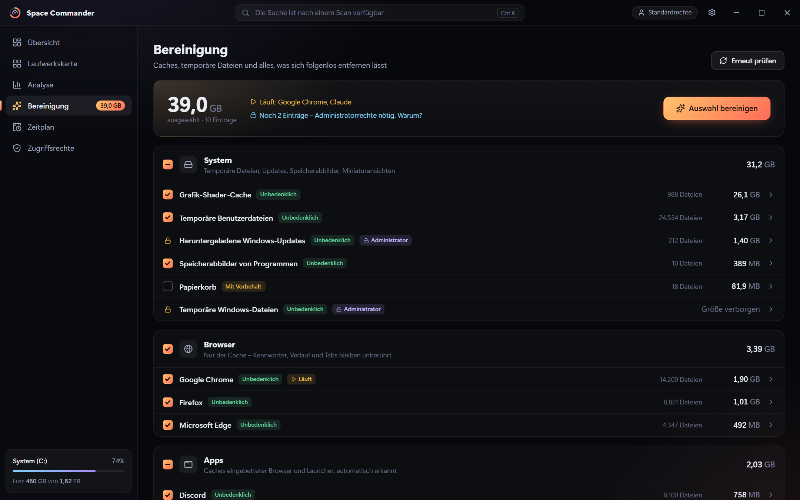 | 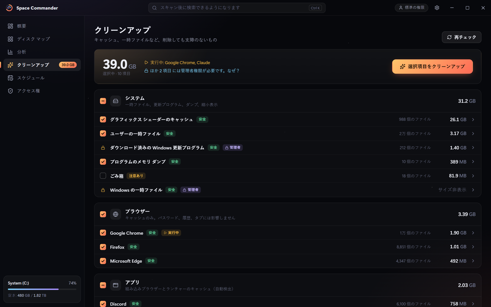 |

Russian is the source language. The English text was written alongside it; the other six translations were produced with AI assistance and have not been reviewed by native speakers, so corrections are very welcome. Each language is one file in [`src/locales`](src/locales), and `npm run i18n` checks that nothing is missing.

## What it never does

- Installs no services or drivers and does not add itself to startup
- Sends nothing over the network: there is no telemetry, cloud or auto-update
- Does not open file contents, only names and sizes (the duplicate finder, which you start yourself, is the one exception)
- Deletes nothing without a confirmation that lists what will go

The web interface has no direct file access. It can only call a fixed set of commands in the Rust core.

## Build from source

Requirements: Windows 10 or 11 (developed and tested on Windows 11), Rust (stable, MSVC toolchain), Node.js 24 or newer. WebView2 ships with Windows 11.

```bash
npm install
npm run tauri dev
```

Build the installer (written to `src-tauri/target/release/bundle/nsis/`):

```bash
npm run tauri build
```

Checks:

```bash
npx tsc --noEmit
npm run i18n
cd src-tauri && cargo test --lib
```

The core can be exercised without the interface:

```bash
cd src-tauri
cargo run --release --example scan -- walk C:\
cargo run --release --example scan -- junk
cargo run --release --example scan -- apps
```

`scan -- mft C` needs a terminal running as administrator.

The screenshots and clips in this README are generated from built-in demo data, not from a real disk: run `npm run dev` and then `npm run media`.

## Project layout

| Path | Contents |
|---|---|
| `src-tauri/src/scan_walk.rs` | Parallel folder walk |
| `src-tauri/src/scan_mft.rs` | `$MFT` reader |
| `src-tauri/src/tree.rs` | The file tree in a flat arena and every query on it |
| `src-tauri/src/junk.rs` | Cleanup rules and safe deletion |
| `src-tauri/src/snapshot.rs` | Folder size snapshots and their comparison |
| `src-tauri/src/cache.rs` | On-disk cache of the last scan |
| `src-tauri/src/apps.rs` | Installed games and programs |
| `src-tauri/src/schedule.rs` | Task Scheduler integration, history, headless runs |
| `src-tauri/src/lib.rs` | Tauri commands |
| `src/views/` | Screens |
| `src/locales/` | Translations |

App data lives in `%APPDATA%\SpaceCommander` (tasks, history, snapshots) and `%LOCALAPPDATA%\SpaceCommander` (scan cache).

## Limitations

- Windows only. Fast mode works on NTFS volumes only.
- In regular mode hard links are counted once per name, so `C:\Windows\WinSxS` looks larger than it is.
- The two scan modes count slightly differently, so compare scans made in the same mode.
- The installer is not code-signed, so Windows SmartScreen will warn about it.

## License

[MIT](LICENSE)
